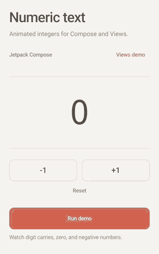
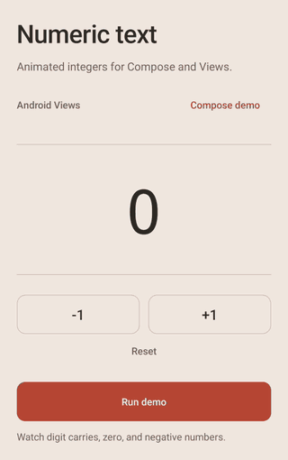
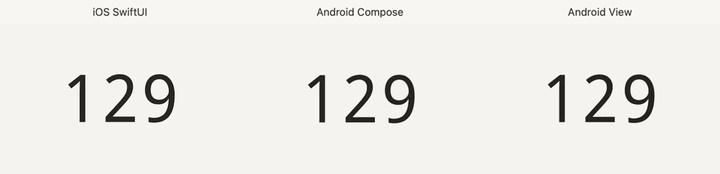

# AndroidNumericText

A small Kotlin integer-animation component for Android Views and Jetpack Compose, inspired by SwiftUI's numeric text transition.

This began as an older Android UI experiment. The 1.1.0 refresh turns both implementations into a reusable library, replaces the demo UI, and corrects the original README: **this is an animated integer display, not a numeric input or formatting SDK**.

> **v1.2.0** includes the SwiftUI-calibrated animation and the real iOS/Android comparison below. Earlier `v1.1.0` artifacts retain the previous motion.
>
> **Unreleased fixes and performance optimizations:** this checkout improves interrupted View/Compose animations, exact-layout reuse, View drawing/layout overhead and software blur preparation. The published `v1.2.0` dependency below does **not** include these changes yet. Demo GIFs show v1.2.0's isolated transitions.

## Demo

<table><tr><th>Jetpack Compose</th><th>Android Views</th></tr><tr><td></td><td></td></tr></table>

Recorded from the actual minimalist demo app: no divider grid or outlined step controls, a number centered in the safe viewport, and actions at the bottom. Cropped to 320 px wide, sampled at 20 fps, compressed to 32 colors, and stripped of duplicate frames while preserving timing. Both GIFs together are approximately **293 KiB**, down from approximately **1,067 KiB** for the original recordings. No external image service is required.

### iOS / Android comparison



Actual iOS 18 SwiftUI and Android API 34 recordings—not a simulated iOS animation. All three use **Droid Sans Mono at 88 pt/dp**, a 500 ms base transition, and the same inputs at approximately 1.2-second intervals: `129 → 130 → 139 → 140 → 99 → 100 → 98 → 0 → −1 → −10 → 42`. SwiftUI uses `.contentTransition(.numericText(value:))` with `.smooth(duration: 0.5)`.

The crops stay centered on each platform's safe viewport. Device pixel ratios are normalized, then the combined GIF is reduced to 720 px / 20 fps / 32 colors, approximately **537 KiB**. Only the first transition is aligned in time; there is no per-digit repositioning, per-transition retiming, or speed change. Scheduling and screen-recording jitter remain visible.

The View previously centered text using the font's maximum `top/bottom` extents, which placed it about 5 normalized pixels below the native reference. It now uses line `ascent/descent`; the three steady `129` glyph bounds differ by at most 1 pixel in the 320 px-wide normalized reference crops. View blur now interpolates adjacent cached levels rather than switching abruptly. These corrections improve alignment and continuity, **not a claim of pixel-identical motion**; rendering, spring approximation, and interrupted-update differences remain.

## Install

Add JitPack once in your project's `settings.gradle.kts`:

```kotlin
dependencyResolutionManagement {
    repositories {
        google()
        mavenCentral()
        maven { url = uri("https://jitpack.io") }
    }
}
```

Then add one library dependency in your app module:

```kotlin
implementation("com.github.ZionHeZY:AndroidNumericText:v1.2.0")
```

The library supports Android **API 21+**; the demo requires API 26+. Both APIs are in the same AAR. Compose dependencies are included transitively, so this is not a Compose-free View-only artifact. To use the composable, enable Compose and configure a Kotlin-compatible Compose compiler in your host project.

## Jetpack Compose

```kotlin
import androidx.compose.ui.graphics.Color
import androidx.compose.ui.text.TextStyle
import androidx.compose.ui.text.font.FontFamily
import androidx.compose.ui.text.font.FontWeight
import androidx.compose.ui.unit.sp
import tech.hezy.numerictext.AnimatedNumber

AnimatedNumber(
    number = count,
    style = TextStyle(
        fontSize = 48.sp,
        fontFamily = FontFamily.Monospace,
        fontWeight = FontWeight.Medium
    ),
    color = Color(0xFFB84636),
    animationDurationMillis = 240
)
```

`count` is an `Int` owned by your app. Use `rememberSaveable` or your existing state holder when it must survive recreation. `modifier` controls layout, padding and semantics. Full `TextStyle` customization is supported; the explicit `color` parameter overrides `style.color`. Supply a theme-appropriate color rather than relying on a Material theme default.

## Android Views

Declare `xmlns:app="http://schemas.android.com/apk/res-auto"` on your layout root:

```xml
<tech.hezy.numerictext.AnimatedNumberView
    android:id="@+id/number"
    android:layout_width="wrap_content"
    android:layout_height="wrap_content"
    android:padding="8dp"
    app:textSize="48sp"
    app:textColor="#B84636"
    app:animationDuration="240" />
```

```kotlin
import android.graphics.Color
import android.graphics.Typeface
import android.util.TypedValue
import tech.hezy.numerictext.AnimatedNumberView

val number = findViewById<AnimatedNumberView>(R.id.number)
number.typeface = Typeface.create("serif", Typeface.BOLD_ITALIC)
number.setTextSize(TypedValue.COMPLEX_UNIT_SP, 48f)
number.textColor = Color.argb(128, 20, 70, 160)
number.animationDurationMillis = 240
number.setNumber(count)
```

Custom font resources can be loaded by your host app and assigned as a `Typeface`. `textSizePixels` is available for pixel-based sizing. Read the current target using `number.number`. Call View APIs on the main thread. Persist the integer in your own state holder and restore it with `setNumber`; the View is not the model.

## Behavior and customization

| Capability | Android View | Compose |
|---|---|---|
| Animation | Per-character short roll, blur and fade; unchanged characters remain sharp | Per-character short roll, blur and fade; unchanged characters remain sharp |
| Typography | `Typeface`, `setTextSize`, `textSizePixels` | Full `TextStyle` |
| Color | ARGB, including transparency | `Color`, including transparency |
| Placement | Standard View layout and padding | Standard `Modifier` |
| Timing | `animationDurationMillis` / XML `animationDuration` | `animationDurationMillis` |

The v1.2.0 renderer uses a **500 ms per-character base duration**, a no-bounce spring curve, and left-to-right staggering. Staggering can add up to 48% to the complete transition. Changed digits travel a fraction of the font size and simultaneously scale, blur and fade, rather than rolling a full line height. Blur is real raster blur on API 21+, not an opacity-only substitute. Persistent minus signs and unchanged digits stay sharp; signs fade without rolling.

Set duration to **0** for immediate updates. Negative durations and invalid View font sizes are rejected. Increasing values move upward; decreasing values move downward. The initial number appears immediately. Width changes interpolate instead of reserving the maximum width and snapping afterward; no leading zeroes are inserted.

The View cancels animation when hidden or detached. System animation settings are respected; disabling animations does not leave stale digits. Accessibility exposes the latest complete integer, not separate animated fragments.

Both implementations retarget from the currently displayed positions, opacity and phase instead of completing the previous target or restarting every digit's delay. Rapid updates shorten the base duration to twice the faster of the last two update intervals, normally at least 16 ms but never longer than the configured duration; pauses restore isolated-click timing. Continuous updates do not reintroduce carry staggering.

This is not input debouncing: the host still accepts every click and owns the latest integer. Compose prepares one layout at a time and retains only the newest pending display request, so slow raster preparation cannot accumulate a queue or restart indefinitely. Rendering can skip intermediate values under load, but converges to the latest accepted value. Cold glyph preparation leaves the latest sharp text visible; an obsolete first layout cannot roll it back. Accessibility and `AnimatedNumberView.number` expose the latest integer immediately.

### SwiftUI reference and fidelity

Motion was compared with an actual iOS 18 SwiftUI `Text` using `.contentTransition(.numericText(value:))` and `.smooth(duration: 0.5)`, including carries, shrinking values and negative signs. A second native reference uses the same Droid Sans Mono font as Android to separate font differences from animation differences.

Same-font early carry frames were fitted as a blend of translated, scaled and Gaussian-blurred glyphs: normalized travel approximately `0.42 em`, scale `0.4 + 0.6 × opacity`, Gaussian blur approximately `0.12 em × (1 − opacity)`, and adjacent-character phase offset approximately 117 ms for a 500 ms base transition. The no-bounce curve uses a fitted normalized coefficient of 10.6. These are measured approximations from this reference, not public SwiftUI constants or a claim of zero pixel error.

The implementation approximates those observed character, blur, phase and width behaviors. It does **not** promise byte-identical frames: CoreText and Android rasterization differ, Apple's internal spring/blur parameters are not public, and the normalized travel/blur settings are visual fits rather than Apple constants. Android does not bundle Apple's SF font.

**Scope:** signed `Int` values, including `Int.MIN_VALUE` and `Int.MAX_VALUE`, rendered as ASCII integer text. No decimals, currency, grouping separators, editable input, or minimum/maximum input validation. Apply domain validation in your own state layer. Very large text or integers need sufficient parent width, or a horizontally scrollable container as demonstrated by the app.

### Performance boundaries

The View reuses one animator, bounded per-character layer states and cached alpha-mask blur rasters. Target width is cached; fixed-width measurement skips animation-driven layout requests, while wrap-content remeasures only when the integer desired width changes. Sharp glyphs avoid identity canvas transforms. The eight blur levels and width interpolation remain unchanged.

Compose uses an 8 MiB / 24-entry glyph LRU and retains the current layout's working set. A typography-scoped, 16-entry exact-number layout LRU skips shaping, bitmap snapshots and pixel-key generation on repeated values, including gradient/shadow layouts. Reused layouts receive fresh request timestamps and durations. Glyph eviction also removes dependent layouts, so this additional cache does not extend raster retention. Active transitions and the working set can retain evicted glyphs: the glyph LRU is not a total memory cap.

New Compose values still shape and draw a typography/Brush snapshot on the UI thread; pixel extraction and missing blur generation run in one background preparation pipeline. Removing the component or changing its typography cancels obsolete work. Software Gaussian blur precomputes valid sample ranges and strides without changing sample order, float accumulation or rounding. No sharp-text fallback replaces blur during an animation.

This is **not a claim of globally optimal performance**. Unseen values still require raster preparation; gradient/shadow cold preparation remains expensive. Cold starts, large fonts and many simultaneous components need workload-specific profiling. Android does not promise pixel-identical SwiftUI spring or raster output.

Historical **v1.2.0**, pre-fix API 34 emulator Debug profiling of the native comparison sequence reported 30.95% janky frames for View and 34.34% for Compose in an initial run. A later Compose run after the equal-width optimization reported 7/301 janky frames (2.33%), sampled UI work at approximately 1.95 ms p95, and a 70 ms UI outlier. Substantial buffer/GPU waiting and run-to-run variability prevent attributing that difference solely to the code change. These are whole-demo observations, not isolated component benchmarks, release-build measurements, measurements of this rapid-input fix or real-device guarantees.

## Build and verify

Use JDK 17 and Android SDK 35. The wrapper uses Gradle 8.9; the project uses AGP 8.7.0, Kotlin 1.9.24 and Compose compiler 1.5.14.

```sh
./gradlew :app:assembleDebug :app:assembleDebugAndroidTest \
  :app:lintDebug :numeric-text:lintRelease \
  :numeric-text:publishReleasePublicationToVerificationRepository
./scripts/verify-consumer.sh
```

The consumer script builds a separate app from published Maven metadata, not a project dependency. It exercises customized Compose and View usage without adding a separate Compose BOM. To verify the public coordinate:

```sh
./scripts/verify-consumer.sh https://jitpack.io v1.2.0
```

With an emulator attached, install both debug APKs and run the behavioral smoke checks:

```sh
adb install -r app/build/outputs/apk/debug/app-debug.apk
adb install -r app/build/outputs/apk/androidTest/debug/app-debug-androidTest.apk
adb shell am instrument -w \
  tech.hezy.androidnumerictext.test/tech.hezy.androidnumerictext.NumericSmoke
```

Exercise the actual demo controls with 12 increments, 12 decrements and eight rapid direction reversals:

```sh
adb shell am instrument -w -e showcase compose-rapid \
  tech.hezy.androidnumerictext.test/tech.hezy.androidnumerictext.NumericSmoke
adb shell am instrument -w -e showcase views-rapid \
  tech.hezy.androidnumerictext.test/tech.hezy.androidnumerictext.NumericSmoke
```

The rapid scenarios compare actual numeric-area screenshots 300 ms after the final click and 500 ms later, rather than checking accessibility text alone. Run with system animator scale set to 1.

Require a `PASS:` result; Android instrumentation can return a zero process exit code even on failure. Checks cover signed integer rendering, rollover measurement, interrupted-frame continuity, custom typography and alpha, unchanged leading-digit pixels during a carry, interrupted Compose gradient/shadow rendering versus immediate text, disabled animation, visibility/detachment, recreation and demo cancellation. Local verification uses API 34. CI is configured for an independent consumer build and enabled/disabled animation checks on API 26 and 35.

For optimization fidelity, install the **original application APK** with the updated instrumentation APK and capture a baseline before installing the optimized application APK. Keep the same device, density, fonts and animation scale (`1`) for both runs; capturing the optimized version twice is not an original-version comparison.

```sh
adb shell am instrument -w -e showcase performance-baseline \
  tech.hezy.androidnumerictext.test/tech.hezy.androidnumerictext.NumericSmoke
# Install the optimized application APK without clearing application data.
adb shell am instrument -w -e showcase performance-after \
  tech.hezy.androidnumerictext.test/tech.hezy.androidnumerictext.NumericSmoke
```

The runner stores raw dimensions/ARGB, PNG View frames, float-bit transition metadata and p50/p95 timings under the application's external `numeric-proof/performance-{baseline,after}` directories. It compares 360 actual View draw frames and every Compose sharp/blur raster and transition snapshot, covering carries, growth/shrink, signs, integer boundaries, interrupted reversals, proportional italic/alpha typography, gradient/shadow and RTL. Compose intermediate-screen fidelity is **not** captured deterministically: its actual atlas pixels and transition inputs are compared, and existing live Compose carry and styled screenshot smoke checks exercise the unchanged Canvas renderer. Timings cover real preparation and software View drawing, not isolated GPU throughput or release-device frame-rate guarantees.

Local API 34 emulator Debug verification compared **51,028,596 pixels**, 360 View frames and 4,032 frame/glyph rasters with **zero differences** in dimensions/ARGB and transition metadata at fixed phases. Original iOS recordings remain a visually fitted reference, not a cross-platform zero-error baseline. Preparation timing includes dispatch/reflection overhead; View drawing timing uses a software Canvas. No end-to-end jank-rate or global-optimality claim follows from these component measurements.

Representative repeated A/B preparation measurements on the same isolated API 34 emulator (32 sp Compose styles, milliseconds, **p50**, 160 warm samples / 40 cold samples):

| Actual preparation path | Original | Optimized |
|---|---:|---:|
| Repeated number, monospace | 3.893 | 0.0188 |
| Repeated number, proportional italic / alpha | 4.210 | 0.0172 |
| Repeated number, gradient / shadow | 3.361 | 0.0141 |
| New atlas, gradient / shadow, LTR | 117.113 | 83.805 |
| New atlas, gradient / shadow, RTL | 122.101 | 81.995 |

Pure-color cold preparation did not show a consistent improvement (representative monospace p50: 1.850 → 1.965 ms); it still creates blur rasters. Software View drawing showed a much smaller p50 change (monospace: 12.50 → 11.79 µs), with variable tails across runs. These are component wall-clock observations, not frame-rate multipliers or guarantees for release builds and real devices.

## Unreleased changes

- Reuse bounded exact-number Compose layouts without changing shaping, raster pixels or interrupted-update request timing.
- Avoid redundant View width summation, fixed-width layout requests and identity drawing transforms.
- Reduce software Gaussian sampling overhead while preserving all eight blur levels and exact accumulation order.
- Preserve current glyph positions and phase during rapid updates and reversals; do not snap to an obsolete target.
- Adapt continuous-update timing without restarting carry delays or discarding click input.
- Keep the current Compose glyph working set, crop new blur rasters and move pixel/effect preparation off the UI thread.
- Prepare one Compose display target at a time, with only the newest request pending.
- Extend the existing smoke runner with real rapid-control and customized typography rendering checks.

## 1.2.0 changes

- Approximate native SwiftUI numeric motion with per-character spring timing, scale, real blur, fade and animated width.
- Keep unchanged digits and persistent minus signs sharp; respect system-disabled animation.
- Correct View baseline alignment and interpolate cached blur levels without per-frame raster generation.
- Simplify both demo layouts and add compressed, actual iOS/Compose/View comparison recordings.
- Preserve the existing signed-integer APIs and document remaining fidelity and performance limits.

## 1.1.0 changes

- Publish both View and Compose APIs from `numeric-text`; remove the app-only composable.
- Replace per-digit animators with one reusable View animator and cached drawing buffers/metrics.
- Fix `wrap_content`, signed values, animation duration, accessibility and lifecycle handling.
- Expose typography, color and animation customization with an independently consumed artifact.
- Refresh both working demos, shrink README recordings, and add reproducible publishing and behavioral verification.

## License

[MIT](LICENSE). Issues and pull requests are welcome at [ZionHeZY/AndroidNumericText](https://github.com/ZionHeZY/AndroidNumericText).
